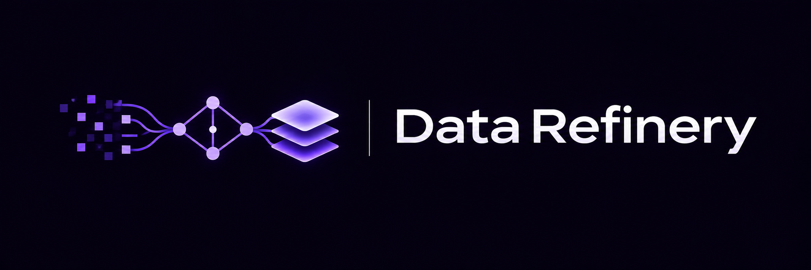
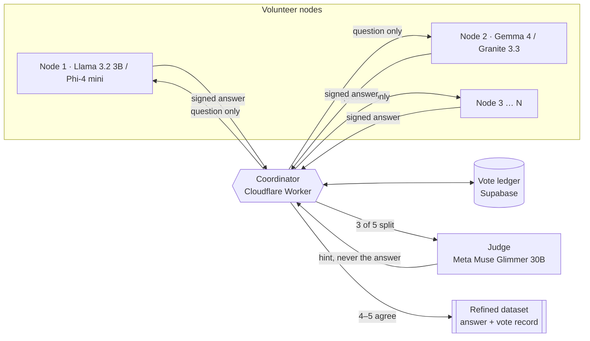

<p align="center">
  
</p>

<p align="center">
  <b>Reliable training data from small open models that verify each other.</b><br>
  Five small models answer every item. Only what they agree on is kept.
</p>

<p align="center">
  <a href="https://data-refinery.primemax.workers.dev">Live dashboard</a> ·
  <a href="https://data-refinery.primemax.workers.dev/audit">Case study</a> ·
  <a href="https://data-refinery.primemax.workers.dev/future">Decentralisation</a>
</p>

---

## Main result

<table>
<tr>
<td align="center"><h1>20% → 2.4%</h1>wrong labels in the dataset,<br>before and after refining</td>
<td>

We hid **10 wrong answers among 50** maths problems. The models never saw the given answers, solved each problem themselves, and **fixed 9 of the 10**. One correct label was changed in error; 8 unclear items were sent for review instead of being kept.

**An 8× cleaner dataset, with no human labelling.**

</td>
</tr>
</table>

| Experiment | One model alone | After refining |
|---|---|---|
| Error detection (50 labelled problems) | 78% | **97.6%** |
| Maths, ten model families (500 problems) | 81% | **98.6%** |
| Maths, Llama only (1,350 problems) | 74% | **98.7%** |

*Share of answers that were correct, checked afterwards against official answers the nodes never saw.*

## How an item is decided

| | | |
|---|---|---|
| **01** | **5 independent votes** | No node sees another's answer |
| **02** | **4–5 agree → accepted** | Strong consensus is kept |
| **03** | **3 agree → hint, re-vote** | Meta Muse Glimmer hints, never answers |
| **04** | **≤2 agree → rejected** | Unsure items never enter the data |

**More agreement, more accuracy** (500 maths problems):

| Votes in agreement | 5 of 5 | 4 of 5 | 3 of 5 | 2 of 5 |
|---|---|---|---|---|
| Answer correct | 99.6% | 98.7% | 90% | 80% |

## Architecture



<details>
<summary><b>What happens to bad votes</b></summary>

- **Never become data:** a disagreeing answer is outvoted; only the consensus answer is written to the dataset
- **Kept as evidence:** every vote stays in the ledger and in each item's exported record
- **Count against the node:** no credit for outvoted answers; repeated failures on test items trigger quarantine
- **Useful later:** wrong answers next to the accepted one can form *rejected vs chosen* pairs for preference training

</details>

<details>
<summary><b>Anti-cheating and integrity</b></summary>

- **Honeypot questions:** a few test items with known answers, hidden among real data; nodes below 30% are quarantined
- **HMAC-SHA256 signatures:** every answer is signed with the node's secret key
- **Blind voting:** nodes receive only the question, never other answers
- **Timing checks:** answers faster than the model could compute are discarded
- **One vote per node per item:** job leases and duplicate checks
- **Judges can't decide:** signed hints only; answers and option letters are scrubbed out
- **Model diversity:** ten model families, so no single model's blind spot wins
- **Credit for agreeing with consensus:** no answer key needed
- **Full audit trail:** every signed vote is stored and can be recounted

</details>

<details>
<summary><b>Infrastructure: demo today, production next</b></summary>

| | Now (hackathon demo) | Production upgrade |
|---|---|---|
| Coordinator | Cloudflare Workers, free tier | Paid Workers + Durable Objects, multiple regions |
| Database | Supabase Postgres, free tier | Managed Postgres with replicas, or a public vote ledger |
| Nodes | Free Colab and Kaggle GPUs | One-click client on volunteer PCs and partner GPUs |
| Judge | Muse Glimmer 30B on Kaggle | Dedicated judge pool, 30–70B models |

The free tiers keep the demo at zero cost. The code is the same; only the hosting plan changes.

</details>

## Research foundation

| Paper | How it supports this project |
|---|---|
| [**Weak-to-Strong Generalization**](https://arxiv.org/abs/2312.09390) · OpenAI, 2023 | A strong model can learn from weaker supervisors; consensus filtering gives it cleaner weak labels |
| [Self-Consistency](https://arxiv.org/abs/2203.11171) · Google, 2022 | Majority vote beats any single answer; we vote across different models |
| [LLMs Can Self-Improve](https://arxiv.org/abs/2210.11610) · Google, 2022 | Training on high-agreement answers improves a model |
| [More Agents Is All You Need](https://arxiv.org/abs/2402.05120) · Tencent, 2024 | Accuracy grows with the number of voters |
| [Pervasive Label Errors](https://arxiv.org/abs/2103.14749) · MIT, 2021 | Even benchmark test sets contain wrong labels |
| [GSM8K](https://arxiv.org/abs/2110.14168) · OpenAI, 2021 | The maths benchmark used for verification |
| [GPQA](https://arxiv.org/abs/2311.12022) · NYU, 2023 | Expert questions; where small models stop |

## Future: decentralisation

Every idle GPU becomes part of the refinery. Home PCs run small voter models, larger GPUs act as judges, dataset owners fund a reward pool, and contributors are paid for verified work.

**Roadmap:** public vote ledger → multiple coordinators → one-click idle client → reward payouts → private datasets

Try the [scale and cost calculator](https://data-refinery.primemax.workers.dev/future).

## Repository

```
coordinator/   Cloudflare Worker: job assignment, vote counting, hints, dashboard pages
node/          node.py (volunteer node), judge.py (judge node), Colab and Kaggle launchers
scripts/       dataset loaders and exports
assets/        logo
```

**Run a node** (Colab or any machine with Ollama and a GPU):

```bash
curl -s https://data-refinery.primemax.workers.dev/colab.sh | bash -s <name> <join-code> <task>
```

Built for the **Meta Global AI Developer Hackathon** (Indie track). Voters include Meta Llama 3.2; the judge is Meta Muse Glimmer 30B.

## License

Copyright © 2026 Maheswar Praveen. All rights reserved. See [LICENSE](LICENSE). The source is published for viewing and evaluation only; no permission is granted to use, copy, modify or distribute it.
